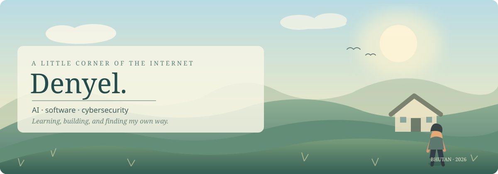
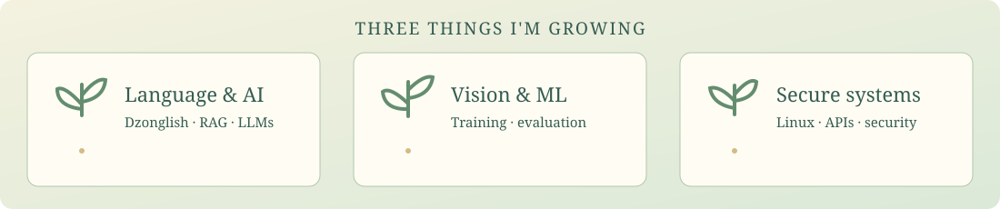

<!-- A quiet countryside, animated in SVG. Original artwork created for this profile. -->

  

  <a href="https://www.linkedin.com/in/denyelcnamgyal">LinkedIn</a> &nbsp;·&nbsp;
  <a href="https://github.com/denyelcnamgyal42-hash?tab=repositories">Projects</a> &nbsp;·&nbsp;
  <a href="https://github.com/denyelcnamgyal42-hash">GitHub</a>

### 🌱 A little about me

Hello, I'm **Denyel**, a Computer Science student at **Gyalpozhing College of Information Technology**, Bhutan.

I'm studying **AI & Data Science** and exploring **cybersecurity**. I enjoy making things work from end to end: collecting data, training models, writing APIs, building systems and learning why they break.

I'm especially interested in building useful technology for Bhutan, including tools for low-resource languages and more secure digital systems.

### 🍃 What I'm growing

- **Language & AI:** low-resource NLP, retrieval and thoughtful LLM applications.
- **Vision & machine learning:** experiments, evaluation and bringing models into usable tools.
- **Secure systems:** Linux, secure backend development and practical security labs.

### 📖 A few things I've built

**[DzonglishNLP](https://github.com/denyelcnamgyal42-hash?tab=repositories)** — Working with Romanized Dzongkha–English text, token-level language identification and spelling variation.

**Smart Attendance** — Face detection and recognition using YOLO, FaceNet, Flask and MySQL.

**JobScoutAI** — A job discovery and matching backend with FastAPI, PostgreSQL and ranking pipelines.

### 🧺 My little toolbox

  

Other tools I use

| Area | Tools |
| :--- | :--- |
| Machine learning | Scikit-learn, NumPy, Pandas, TensorFlow, OpenCV, YOLO |
| Language applications | LangChain, FAISS, Chroma, Ollama, Groq |
| Backend | Node.js, Express, MongoDB |
| Security learning | Nmap, Burp Suite, OWASP ZAP, Kali Linux |

### ☁️ Outside the screen

Football, anime, travel and the occasional rabbit hole about how something works. I like the idea of getting a little better every day.

If you're building something in **AI, language technology or security**, I'd be happy to connect.

🐍 My contribution garden (snake animation)

  <picture>
    <source media="(prefers-color-scheme: dark)" srcset="https://raw.githubusercontent.com/denyelcnamgyal42-hash/denyelcnamgyal42-hash/output/github-contribution-grid-snake-dark.svg" />
    <source media="(prefers-color-scheme: light)" srcset="https://raw.githubusercontent.com/denyelcnamgyal42-hash/denyelcnamgyal42-hash/output/github-contribution-grid-snake.svg" />
    
  </picture>

