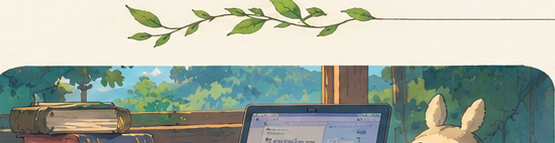
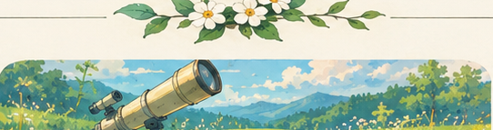
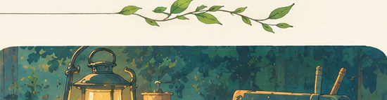
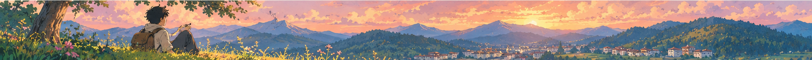

  

<h1 align="center">Denyel Chokey Namgyal</h1>

<b>AI & Data Science · Software Engineering · Cybersecurity</b> Final-year Computer Science student · Bhutan

  <a href="https://www.linkedin.com/in/denyelcnamgyal">LinkedIn</a> ·
  <a href="https://github.com/denyelcnamgyal42-hash?tab=repositories">Projects</a> ·
  <a href="https://github.com/denyelcnamgyal42-hash">GitHub</a>

### A little about me

I study Computer Science at **Gyalpozhing College of Information Technology**. My primary focus is **AI and Data Science**, with a growing interest in **cybersecurity and secure backend systems**.

I like taking ideas beyond notebooks: collecting data, training and evaluating models, building APIs, connecting databases, testing, and deploying something people can actually use. I'm especially interested in **low-resource language technology** and building technology that can benefit Bhutan.

### Selected work

<table>
<tr>
<td width="33%" valign="top">

<b>DzonglishNLP</b> 
Token-level language identification and spelling variation research for Romanized Dzongkha–English text. Python · XLM-R · CRF · NLP
</td>
<td width="33%" valign="top">

<b>Smart Attendance</b> 
A computer-vision attendance prototype using face detection and recognition, with a web dashboard. YOLO · FaceNet · Flask · MySQL
</td>
<td width="33%" valign="top">

<b>JobScoutAI</b> 
A job aggregation and matching backend with filtering, ranking, and automated tests. FastAPI · PostgreSQL · Python
</td>
</tr>
</table>

Explore the <a href="https://github.com/denyelcnamgyal42-hash?tab=repositories">repositories</a> for implementation details and demos.

### What I bring to a team

- **Applied AI:** model training, evaluation, computer vision, NLP, and retrieval-based applications.
- **End-to-end development:** Python APIs, relational databases, integration, Docker, Linux, and Git.
- **Security mindset:** secure coding, basic web security testing, and learning how systems fail.
- **Working style:** independent learning, analytical problem-solving, and collaborative delivery.

**Currently exploring:** low-resource NLP, reliable LLM applications, and practical application security.

### Tools I reach for

  

Other tools and technologies

| Area | Experience |
| :-- | :-- |
| ML & Data | Scikit-learn, TensorFlow, Pandas, NumPy, OpenCV, YOLO |
| LLM / Retrieval | FAISS, LangChain, OpenAI and Groq APIs |
| Backend | Node.js, Express, MongoDB |
| Security labs | OWASP ZAP, Burp Suite, Nmap, Kali Linux |

### Beyond the screen

When I'm not working on code, you'll usually find me enjoying **football, anime, or travel**. I value steady progress, curiosity, and making useful things well.

I'm interested in **internships, graduate roles, research collaboration, and meaningful projects** in AI, software development, or security. Feel free to reach out on [LinkedIn](https://www.linkedin.com/in/denyelcnamgyal).

  

Contribution snake

<picture>
<source media="(prefers-color-scheme: dark)" srcset="https://raw.githubusercontent.com/denyelcnamgyal42-hash/denyelcnamgyal42-hash/output/github-contribution-grid-snake-dark.svg" />
<source media="(prefers-color-scheme: light)" srcset="https://raw.githubusercontent.com/denyelcnamgyal42-hash/denyelcnamgyal42-hash/output/github-contribution-grid-snake.svg" />

</picture>

