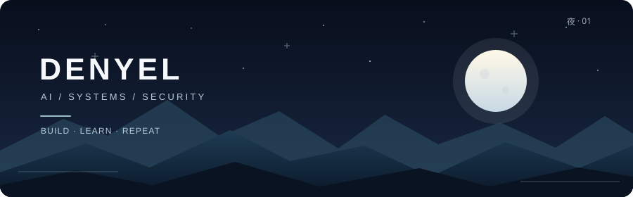

  

  <a href="https://www.linkedin.com/in/denyelcnamgyal">LinkedIn</a>
  &nbsp;&nbsp;·&nbsp;&nbsp;
  <a href="https://github.com/denyelcnamgyal42-hash?tab=repositories">Projects</a>
  &nbsp;&nbsp;·&nbsp;&nbsp;
  <a href="https://github.com/denyelcnamgyal42-hash">GitHub</a>

「 一歩ずつ 」 — one step at a time

## Hello, I'm Denyel 👋

I'm a **Computer Science student at Gyalpozhing College of Information Technology, Bhutan**, specializing in **AI & Data Science** while exploring **cybersecurity**.

I enjoy building things from the ground up, understanding how they work, and learning from what breaks. I’m especially drawn to projects that connect machine learning with real applications—from the model to the API, database, and deployment.

My long-term goal is to build useful technology and contribute to a more secure digital future for Bhutan.

## Currently exploring

- **Language AI** — code-mixed Dzongkha–English text, token identification, and low-resource NLP.
- **Applied AI** — LLM applications, retrieval, computer vision, and model evaluation.
- **Cybersecurity** — secure coding, web security, Linux, and practical security labs.

## Selected projects

| Project | What I built / explored |
| :-- | :-- |
| **DzonglishNLP** | A low-resource, Romanized Dzongkha–English NLP pipeline, starting with token-level language identification and spelling normalization. |
| **Smart Attendance** | A computer-vision attendance system using object detection and face embeddings. |
| **Bhutan Cultural Guide** | A retrieval-based assistant for exploring Bhutanese culture and heritage. |
| **JobScoutAI** | A backend project for collecting, filtering, and matching entry-level job listings. |

## My toolkit

  

  
More tools I use

   

  **ML & data:** Scikit-learn, Pandas, NumPy, OpenCV, YOLO  
  **LLM & retrieval:** FAISS, LangChain, Ollama, Groq  
  **Backend:** Node.js, Express, MongoDB  
  **Security labs:** Nmap, Burp Suite, OWASP ZAP, Kali Linux

## Beyond code

When I'm not working on a project, you'll probably find me playing **football**, watching **anime**, or thinking about places I'd like to travel. I believe in consistency over shortcuts—small improvements, made regularly.

  

  Open to connecting with people working on AI, language technology, and security.

  
✦ My contribution trail

   
  

    <picture>
      <source media="(prefers-color-scheme: dark)" srcset="https://raw.githubusercontent.com/denyelcnamgyal42-hash/denyelcnamgyal42-hash/output/github-contribution-grid-snake-dark.svg" />
      <source media="(prefers-color-scheme: light)" srcset="https://raw.githubusercontent.com/denyelcnamgyal42-hash/denyelcnamgyal42-hash/output/github-contribution-grid-snake.svg" />
      
    </picture>
  

